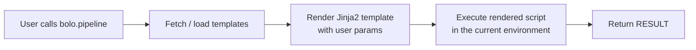

<p align="center">
    <a href="https://github.com/illinoisdata/bolo/blob/main/LICENSE"></a>
    <a href="https://github.com/illinoisdata/bolo-templates/releases"></a>
    <a href="https://pypi.org/project/pybolo"></a>
</p>

<p align="center">
  
</p>

<h1 align="center">Bolo: Curated, Verified, and Ready-to-run Inference Pipelines for HuggingFace Models</h1>

**Bolo** is a lightweight Python library that gives you curated, verified, and ready-to-run inference pipelines for HuggingFace models with ZERO efforts.

## Development

- Each issue must be labeled with a label.
- Every `bug` issue will only be closed when PyPI is updated.
- For `bug` issue, please refer to `tracker` issue for progress.
- For `TODO` issue, please refer to **Notion sprint** for progress (each `TODO` issue contains the specific sprint page).

📦 **Curated templates**: every supported model ships with a tested Jinja2 inference template maintained by the Illinois CreateLab team.

📌 **Pinned requirements**: every model ships with a `requirements.txt` listing its exact dependencies, so you can set up a working environment for it yourself.

⚡ **One-call API**: `bolo.pipeline(repo_id, device="cuda", ...)` conducts inference in one API call, simpler than HuggingFace two-stages `pipeline` API.

🖥️ **CLI included**: a `bolo` command lets you fetch templates and run inference directly from the shell.

🌐 **Auto-fetching templates**: template bundles are downloaded on first use from the [bolo-templates](https://github.com/illinoisdata/bolo-templates) GitHub release and cached locally — no manual setup needed.

## Quick demo

Install bolo:

```bash
pip install pybolo
```

Install the model's dependencies (see [Installing model dependencies](#installing-model-dependencies)), then run inference with two lines of Python:

```python
import bolo

result = bolo.pipeline("<REPO_ID>", device="cuda:0")
print(result)
```

Before running inference you can inspect what parameters the template accepts:

```python
bolo.list_params("<REPO_ID>")
```

## Installing model dependencies

bolo does not install model dependencies for you. Each model's template folder contains a `requirements.txt`; install it into the environment you run bolo from (we recommend one venv per model, since models may pin conflicting versions):

```bash
bolo fetch-templates   # prints the templates directory
uv venv .venv-<MODEL> --python 3.13 && source .venv-<MODEL>/bin/activate
uv pip install -r ~/.cache/bolo/templates/<TEMPLATES_VERSION>/<ORG>__SEP__<NAME>/requirements.txt \
    --extra-index-url https://download.pytorch.org/whl/cu128
```

The folder name is the repo id with `/` replaced by `__SEP__`, e.g. `BeIR/query-gen-msmarco-t5-base-v1` → `BeIR__SEP__query-gen-msmarco-t5-base-v1`.

## CLI

The `bolo` command mirrors the Python API from your shell.

**Run inference** (in an environment with the model's dependencies installed):
```bash
bolo run <REPO_ID> device=cuda:0
```

**Pre-download the templates cache (optional, useful on air-gapped machines):**
```bash
bolo fetch-templates
```

## How does bolo work?

bolo separates *what to run* (the Jinja2 template) from *where to run it* (the environment you set up from the model's `requirements.txt`).



1. **Templates** — stored in the [bolo-templates](https://github.com/illinoisdata/bolo-templates) release bundle. Each model folder contains a `template.j2` (the inference script template) and a `requirements.txt` (the model's exact dependencies). Templates are downloaded once and cached at `~/.cache/bolo/templates/`.

2. **Dependencies** — installed by you from the model's `requirements.txt` (see [Installing model dependencies](#installing-model-dependencies)). Using one venv per model lets you run models with conflicting PyTorch or CUDA versions side-by-side.

3. **Rendering** — template parameters are collected from the leading `` blocks in each `template.j2`. `bolo list_params` shows you every knob with its type and default value.

4. **Execution** — the rendered script is executed and its `RESULT` variable is returned to the caller.

## Install from source

```bash
git clone https://github.com/illinoisdata/Bolo.git
cd Bolo
pip install -e .
```

## Custom templates directory

Set `BOLO_TEMPLATES_DIR` to point bolo at your own templates folder:

```bash
export BOLO_TEMPLATES_DIR=/path/to/my/templates
```

## Platforms
`bolo` is developed and tested on Red Hat Enterprise Linux, with CUDA version 12.8. So all dependencies (`torch`-related) assume the `cu128`.

## Contributing

Contributions are welcome! Please open an issue or pull request on [GitHub](https://github.com/illinoisdata/bolo/issues).

## License

MIT — see [LICENSE](LICENSE) for details.

## Acknowledgement
- Thanks Jojo and her sister for designing the mascot.